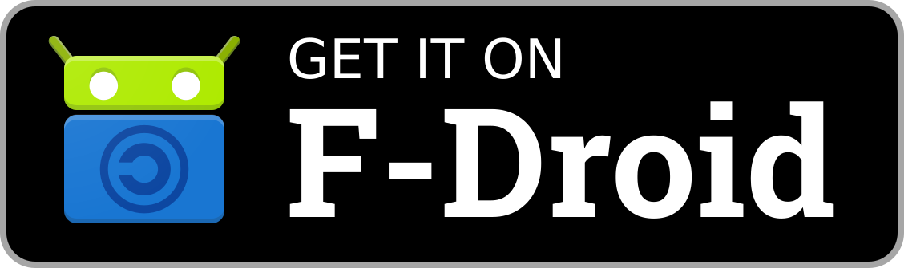
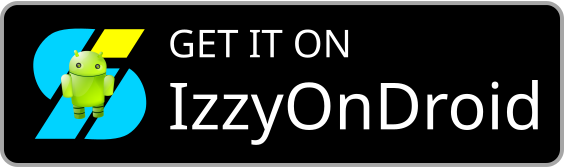
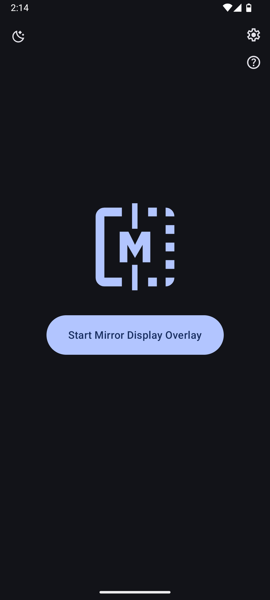
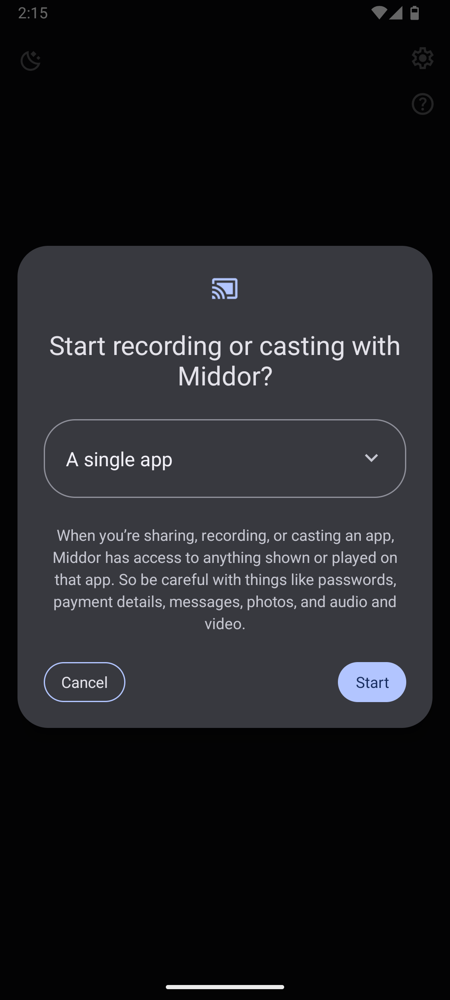
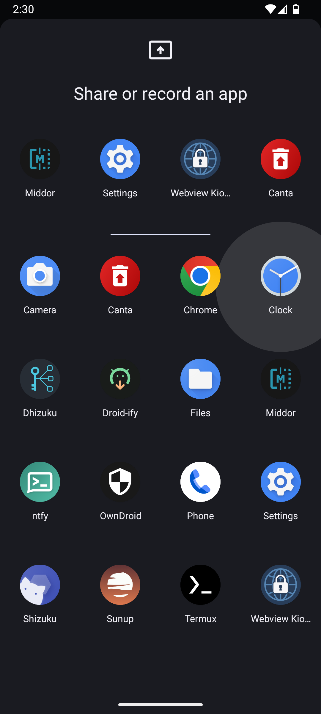
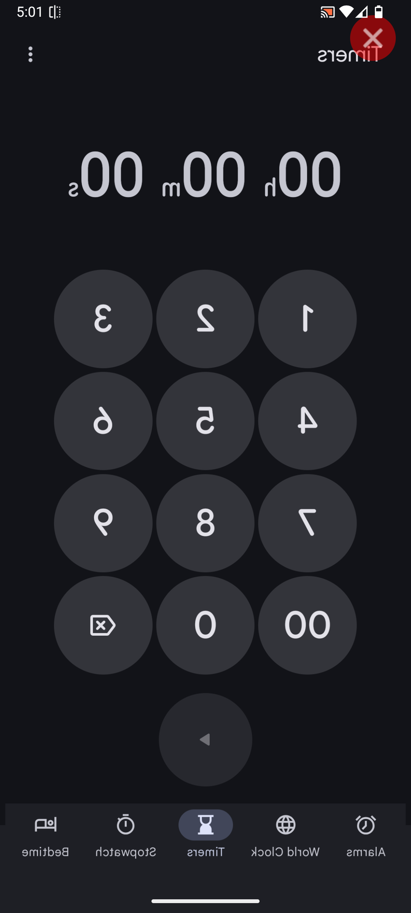
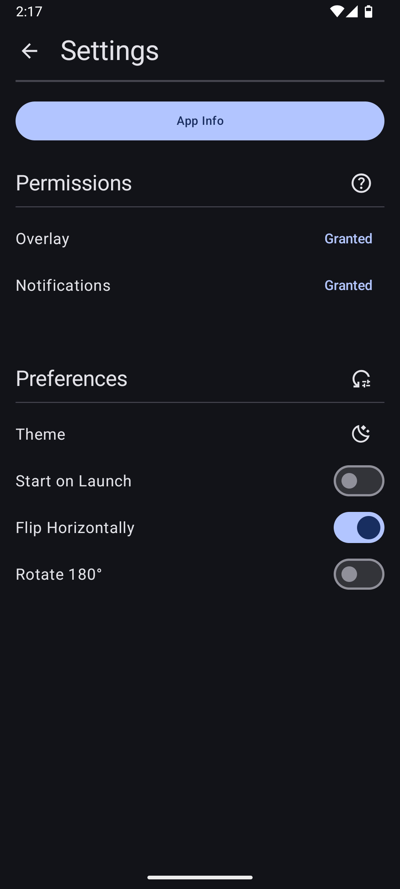
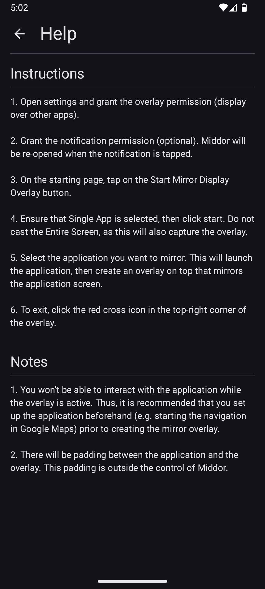

# Middor

Middor is a free and open-source Android application for mirroring apps on your device.

With built-in support for horizontal flip and 180° rotation, Middor can be used to:

- Display apps on a HUD
- Project content onto a car windscreen (e.g. Google Maps navigation)
- View mirrored images and videos

Middor only supports devices running Android 14 QPR2 or higher, as it
relies on the single app screen sharing feature.

The mirror is fully opaque. **Enable Touch Controls** in Middor settings to interact
with the buttons you see in the mirror, then enable **Middor mirrored input** in
Android Accessibility settings. Taps, swipes, and multitouch gestures replay at the
source positions corresponding to the displayed image after finger-up. Input is not streamed in
real time. Physical touches are intercepted throughout the session;
only the synthetic replay is delegated to the hidden app. A replay starts with a held pointer,
then continues only after Android acknowledges delegation, so no input window is removed between
taps. Starting a physical gesture cancels any unfinished replay; canceled actions are not retried.

Turn touch controls off for an opaque, view-only mirror that blocks touches to the
hidden app. Accessibility is optional in this mode. Settings also control touch
feedback (off by default), tap replay duration, and the close-button corner. Restart the mirror to
apply settings changes. The close button is never flipped or rotated with the video.

The optional accessibility service only replays user gestures while mirroring. It
does not request accessibility node contents, subscribe to accessibility events,
collect or share gesture data, change settings, or perform autonomous actions.
Touch interception is enabled before the screen-sharing picker and released when mirroring ends
or capture is canceled. The picker and touches outside the mirror are delegated without mirroring.
After updating from an older version, turn **Middor mirrored input** off and on once in Android
Accessibility settings to refresh its touch-exploration capability. The service does not enable
spoken feedback or require double-tapping to activate controls. The code's
AccessibilityPolicy suppression acknowledges the general API usage notice; it is
not a declaration of app-store policy approval.

For more details, see
[Android 14 - App Screen Sharing](https://developer.android.com/about/versions/14/features/app-screen-sharing).

For usage instructions, see [Discussion #2](https://github.com/nktnet1/middor/discussions/2).

## Permissions

- <b>SYSTEM_ALERT_WINDOW</b>: to draw a mirror overlay on top of other apps
- <b>FOREGROUND_SERVICE</b>: to run the mirror service continuously while the overlay is active
- <b>FOREGROUND_SERVICE_MEDIA_PROJECTION</b>: for capturing the screen content of the underlying app
- <b>BIND_ACCESSIBILITY_SERVICE</b>: (optional) for touch controls with user-enabled gesture replay
- <b>POST_NOTIFICATIONS</b>: (optional) to display the mirror service notification with additional actions

## Contact

- support@middor.nktnet.org

## License

This project is licensed under the GNU Affero General Public License v3.0 or later.

See the [LICENSE](./LICENSE) file for details.

## Screenshots

  &nbsp;
  &nbsp;
  &nbsp;
  &nbsp;
  &nbsp;
  

